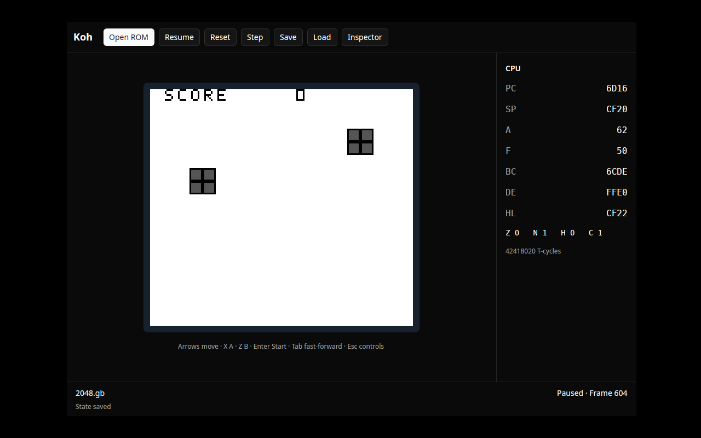
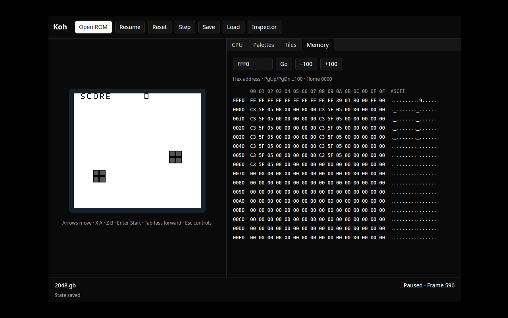
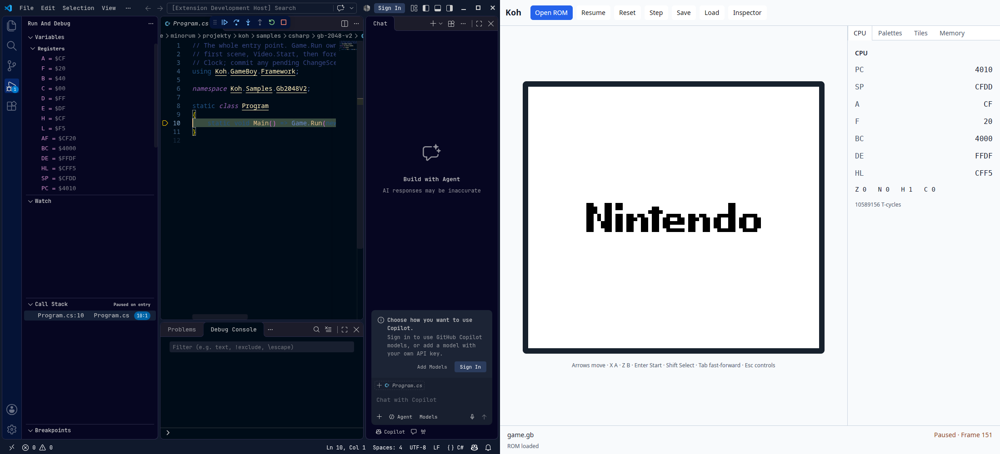

# GPUI desktop migration

Status: GPUI implementation, KohUI removal and package integration complete;
final native platform acceptance in progress.
Baseline: `9ebb6e5`.

## Whole-goal checkpoints

Draft [PR #56](https://github.com/retro-dev-tools/koh/pull/56) tracks this work.
The bar counts completed checkpoints, not estimated effort.

```text
[#########>] 9/10 complete; current: final native acceptance
```

| # | Checkpoint | State / evidence |
| --- | --- | --- |
| 1 | Baseline, scope and draft PR | Done: master updated, parity/removal inventory, PR56 |
| 2 | Initial DWARF writer and bounded reader | Done: banked source/symbol/constant and malformed-input tests |
| 3 | Assembly expansion provenance | Done: nested range/symbol ancestry; exact real 2048 metadata roundtrip; LLVM verification |
| 4 | Managed debugger cutover | Done: native reader binding, neutral records, 42 debugger tests in the passing fast suite |
| 5 | Producers, consumers and KDBG removal | Done: CLI/SDK/editor/sample/fixture cutover; old writer/reader/builder removed; seven SDK sidecars verified |
| 6 | Real DWARF debugging acceptance | Done: 37 compiler/debugger integration cases; Debug/Release SDK 2048, source breakpoints, framework stack recovery and machine state |
| 7 | Windowless engine session | Done: copied coherent snapshots, frame-boundary commands while paused, persistence, DAP coordination; nine NativeAOT process tests and real SDK 2048 run |
| 8 | Complete GPUI Kit interface | Done: four inspectors, native picker, all joypad keys, focus/toolbar behavior, slate light/dark styling and accessible content; Linux native evidence below |
| 9 | Complete KohUI removal and integration | Done: framework/backends/demo/tests removed; windowless engine, launch/editor/install/package/CI paths switched; checked dependency catalog |
| 10 | Final native acceptance | Pending: real-game visual/input/audio, headless regressions and platform validation |

Keep progress reports and this ledger aligned with completed evidence.

## Connected desktop preview

`rust/koh-ui` builds `koh-emulator` with pinned GPUI Kit 0.10.0. Its worker
owns the engine connection; rendering reads copied snapshots. Replies are
bounded to 512 KiB and checked for request ID, protocol version, hardware mode,
image dimensions/alpha and inspector shapes. The parent cooperatively quits
the child and waits for persistence before closing.

On Linux, publish the engine with a compatible .NET SDK, then launch the preview:

```sh
dotnet publish src/Emulator/Koh.Emulator.App -c Release -r linux-x64 -m:1 -o target/gpui-engine
KOH_ENGINE="$PWD/target/gpui-engine/Koh.Emulator.App" cargo run -p koh-ui -- samples/csharp/gb-2048-v2/2048v2.gb
```

Without `KOH_ENGINE`, the UI resolves the engine beside its executable. Empty
startup offers the ROM picker from the window. OS picker failures become visible
errors; the current session survives failed ROM loads. `Esc` switches between
game input and toolbar focus. Controls retain P/R/D/F5/F9 and held Tab shortcuts.
Right Shift activates Select through GPUI modifier events. Its public modifier
state combines both sides, so left Shift also activates Select. Game focus
isolates these bindings from text entry and toolbar navigation. Tab uses a
scoped action so GPUI focus traversal cannot consume held fast-forward input.

Use the [upstream installation guide](https://gpui-kit.com/docs/installation/)
for native prerequisites. CI now installs the Linux build dependencies for the
new workspace member. Only GPUI Kit supplies the widget/platform layers; image,
serde and base64 dependencies handle pixels and the private engine protocol.



### Connected-window evidence

- `cargo build -p koh-ui --locked`: exit 0. Log:
  `/tmp/koh-gpui-window-build-final.log`. Native build used Rust 1.99.0 and
  `CARGO_BUILD_JOBS=2 CARGO_PROFILE_DEV_DEBUG=0` on this constrained host.
- Workspace fast nextest selection: exit 0, 1484/1484 passed, one explicitly
  ignored published-engine test. Log: `/tmp/koh-gpui-workspace-fast.log`.
- The ignored Rust-client integration test was separately executed against the
  fresh NativeAOT engine: exit 0, one test passed. It validates real DMG debug
  snapshots, rejects an overlong path without losing the session, saves state
  and waits for clean child exit. Log: `/tmp/koh-gpui-client-native-final.log`.
- Native GPUI window under owned Xvfb: exact LCD pixels compared with a fresh
  engine PNG; integer pixel replication checked; Enter reached the score
  screen; P froze the whole display; F5 completed a state write; native window
  close returned exit 0. Log: `/tmp/koh-gpui-window-bounded-final.log`.
  The screenshot above was captured from that actual window and reviewed.
- Old framebuffer images are explicitly released from GPUI's sprite atlas.
  In the short five-second running check, RSS went from 228064 to 227856 KiB;
  this is a
  bounded allocation check, not a long-run performance or endurance claim.
- The Rust launcher's headless PNG exactly matched the direct engine output:
  SHA256 `1964cbcc22cf7beb655802065aa06cef477657cb0a5d1ff8aa5f0368b6e86b3d`.
  Log: `/tmp/koh-gpui-headless.log`.

The native window checks use OpenAL's null driver; they do not prove audible
output. Later inspector/input/appearance checks below cover Linux functional
acceptance. Wayland and cross-platform acceptance remain open. KohUI removal,
new GUI dependency notices and packaging are the next checkpoint.

### Inspector increment

CPU, Palettes, Tiles and Memory tabs read coherent engine snapshots. Detailed
snapshots are requested while a non-CPU inspector is visible. Unchanged tile
images retain their texture; replaced textures are explicitly released.
Memory shows 256 bytes in hex and ASCII, accepts 1–4 hexadecimal digits and
supports wrapping PgUp/PgDn navigation and Home. Address entry retains text
focus until submitted; invalid input preserves the current memory window.
The memory pane is wider at normal size, with horizontal overflow at small
sizes. Inspector content scrolls vertically.

- Focused Rust tests including the published-engine case: 8 passed, zero
  ignored, exit 0. `/tmp/koh-gpui-inspectors-tests-final.log`.
- Native build and focused Clippy with warnings denied: exit 0.
  `/tmp/koh-gpui-inspectors-build-final.log` and
  `/tmp/koh-gpui-inspectors-clippy.log`.
- Native DMG window: palette swatch RGB and all 384 tile pixels exactly match
  a second native engine restored from the UI's saved state. Existing LCD,
  Start, pause, save and clean-close assertions still pass. Exit 0:
  `/tmp/koh-gpui-inspectors-dmg-final.log`.
- Reviewed actual captures: memory page wrap, FFF0 entry and wrapped rows,
  invalid input feedback, and the 680×480 minimum window. These are bounded
  Linux/X11 checks; complete keyboard/accessibility and platform acceptance
  remain open.
- CGB fixture writes distinct patterns into both VRAM banks. Both banks'
  complete tile images match restored native snapshots, including bank 1
  after vertical scrolling. The native session supplies eight BG and eight
  OBJ palettes. Exit 0: `/tmp/koh-gpui-inspectors-cgb-pattern.log` and
  `/tmp/koh-gpui-inspectors-cgb-bank1.log`.



The checkpoint ledger above tracks current completion.

### Input, appearance and accessibility

The interface uses slate surfaces, blue primary actions and amber paused status
in both system light and dark modes. CPU values, palette colors, tile-bank
descriptions, memory rows, validation alerts and operation status are exposed
to accessibility tools. Text labels supply their AccessKit value; naming a
static label alone does not expose its contents through AT-SPI.

Native checks in `/tmp/koh-gpui-polish-native-final.log` cover every joypad key,
both Shift keys, text-field isolation, internal focus changes and actual X11
window deactivation. Held Tab advances the core beyond normal pacing and clears
on focus loss. Toolbar Tab/Enter navigation, system light/dark changes, and
the live AT-SPI inspector contents were exercised. The appearance service runs
on a private D-Bus session with `GSETTINGS_BACKEND=memory`; a private bus alone
does not isolate dconf storage.

The native GTK portal picker opens/cancels, loads a ROM whose path contains
spaces, and reports an invalid ROM accessibly while retaining the current ROM.
Log: `/tmp/koh-gpui-picker-native-final.log`.

Empty startup has no default/private ROM, leaves transport inactive and exposes
no disabled-button actions. A native pointer click on disabled Reset produces
no reset command. Opening/cancelling and selecting valid/invalid ROMs work from
this state too. Exit 0: `/tmp/koh-gpui-empty-picker-native.log`.

The real SDK 2048 native window still matches exact engine LCD pixels. P freezes
it, F5 completes a save, R resets the paused core and F9 restores the exact saved
CPU state. Resuming refreshes LCD pixels, which again match the engine snapshot.
Native window close exits 0. Log: `/tmp/koh-gpui-transport-native-final.log`.
The desktop screenshot above is updated from this styled, real-game run.

Focused tests including the published-engine case: 8/8 passed, zero ignored,
`/tmp/koh-gpui-polish-tests.log`. Build, focused Clippy with warnings denied and
Rustfmt check exit 0: `/tmp/koh-gpui-polish-build-final.log`,
`/tmp/koh-gpui-polish-clippy-final.log`,
`/tmp/koh-gpui-polish-format-check.log`.

Two separate proposals remain outside this UI migration:

- Core save states omit framebuffer pixels. Preserve the existing raw format;
  paused restore tells the user to resume to refresh the display. Persisting
  framebuffer pixels requires a separate compatible core-format change.
- The pinned Linux AccessKit adapter reports disabled buttons as sensitive:
  `accesskit_atspi_common` checks read-only support when constructing these
  state flags. Disabled buttons still expose no click action. Track the adapter
  flag correction separately; do not alter semantic button roles to hide it.

## Required outcome

All desktop interface code is Rust using GPUI Kit. Completely remove KohUI,
both backends, demo, tests, dependencies and active build/release references.
Keep the C# emulator, boot ROMs and DAP debugger as the execution engine.
VS Code retains its native editor integration. A shell window or mocked
debugger does not satisfy parity.

## Architecture and appearance

`rust/koh-ui` owns the native window, input, file picker, display, inspector
and status. Use published `gpui-kit` with its matched GPUI version, without
porting the reconciler or introducing another widget framework.

The emulator executable becomes a windowless engine with a private stdio
session for commands and coherent snapshots. Preserve existing DAP transport
and headless screenshot/report modes. Reserve stdout for session messages in
the new mode; route diagnostics/pacing to stderr. The Rust parent owns the
child lifetime. EOF/window close must shut down cooperatively and flush SRAM.
The implemented [session protocol](engine-session.md) is ready for the Rust client.
Process commands at frame boundaries, including while paused. Never read live
mutable arrays from the renderer. Bound messages and validate shapes/enums.
Ship the engine beside the UI and resolve it relative to the executable.

A compact development instrument: LCD left, inspector right, transport above,
status below. Use GPUI Kit theme/controls/focus behavior. Cool slate surfaces,
blue actions, amber paused emphasis, system light/dark support; platform UI
font for controls and monospace for addresses/registers. No decorative chrome
competing with the game. Keep 160x144 nearest integer scaling and scroll the
inspector within the available space. Use an actionable empty state instead
of a private default ROM path. Failed loads preserve the working session.
Typing into fields must not trigger joypad input; focus loss releases held
joypad/fast-forward keys.

```text
Open ROM    [Pause/Resume] [Reset] [Save] [Load]       [Inspector]
+--------------------------------+-----------------------------+
|                                | CPU / Palettes / Tiles / Hex|
|         Game Boy LCD           |                             |
|     nearest / integer scale    | scrollable inspector        |
|                                |                             |
+--------------------------------+-----------------------------+
ROM / status                     Frame count / fast-forward
```

## Acceptance inventory

Recorded from `EmulatorApp.cs`, `Program.cs`, `EmulatorLoop.cs` and
`CpuSnapshot.cs` at baseline. Current Linux evidence is recorded above;
final package/platform acceptance remains checkpoint 10.

| Surface | Required behavior | Evidence needed |
| --- | --- | --- |
| ROM | Native picker, explicit path, cancel, missing/invalid ROM, DMG/CGB boot selection, reset | Real load/reset; failed load retains current session |
| LCD | 160x144 RGBA, opaque alpha, nearest integer scale, no tearing | Known pixel fixture and real DMG/CGB captures at multiple sizes |
| Transport | Pause/resume, reset, held Tab fast-forward | Frames freeze/resume; release/focus loss clears fast-forward |
| Joypad | Arrows, Z=B, X=A, Enter=Start, right Shift=Select | Real-game press/release; fields/focus loss do not stick buttons |
| Shortcuts | P pause, R reset, D inspector, F5 save, F9 load | Keyboard and buttons invoke same engine operation |
| CPU | PC, SP, A, F, BC, DE, HL, T-cycles, Z/N/H/C | Match paused engine; stepping refreshes snapshots |
| Palettes | DMG BGP/OBP0/OBP1; CGB 8 BG and 8 OBJ palettes | Known colors and real snapshots, all swatches visible |
| Tiles | 384 per bank; 128x192 DMG, 128x384 CGB | Bank/bit order, scrolling and crisp rendering |
| Memory | 256 bytes, 16 columns, address/hex/ASCII, bank-aware reads | PgUp/PgDn wrap at 16 bits; Home=0; paused refresh |
| Persistence | `<rom>.sav` battery SRAM, `<rom>.state` state | Real save/relaunch/load; report success after completion |
| Audio | Existing OpenAL pacing | Audible run; pause/reset/load/fast-forward |
| DAP | Launch on the shared core, breakpoints, step, memory, shutdown | Real VS Code session alongside new native window |
| Headless | DAP, PNG, input script, mode3 report, boot overrides | Existing process/framebuffer tests without GUI initialization |
| Access | Keyboard focus, labels, disabled states, contrast | Native keyboard pass and accessibility-tree inspection |

## Removal and integration inventory

- Delete `src/UI/KohUI`, `src/UI/KohUI.Backends.Sdl3`,
  `src/UI/KohUI.Backends.Dom`, `tests/UI`, `samples/ui/KohUI.Demo`,
  `scripts/run-kohui-demo.sh` and `scripts/run-kohui-demo.ps1`.
- Replace `EmulatorApp.cs` widget/model bindings and `Program.cs` backend
  startup. Remove `CpuSnapshot.cs`'s `KohColor` dependency; preserve decoding.
- Remove UI project references from `Koh.Emulator.App.csproj`, `Koh.slnx`,
  `Koh.Ci.slnf` and `Koh.Fast.slnf`.
- Remove SDL3-CS and UI-only packages/assets after checking every consumer
  in `Directory.Packages.props` and project files.
- Update Cargo workspace/lockfile, `build.proj`, launch scripts, PublishDev,
  release-toolchain and CI to build/package the UI and windowless engine.
  Preserve engine filename used by compiler integration tests or update every
  consumer together.
- Replace renderer/input/UI coverage with GPUI/session regressions, without
  keeping the DOM preview to satisfy old tests.
- Update README, CONTRIBUTING, AGENTS/CLAUDE maps and SDL3 documentation.
- Audit tracked references with `git grep -n -i kohui`. Classify history;
  no live namespace, project, dependency or launcher may retain the framework.
- Record Linux, Windows and macOS native evidence independently.

## Implementation order

Prerequisite selected by the user: migrate KDBG to ELF/DWARF first. Preserve
banked source/debugger behavior and prove real source breakpoints and stack
inspection before continuing the UI. See [DWARF migration](dwarf-migration.md).

1. Engine session and real-process regression: commands, coherent snapshots,
   paused operation, errors, EOF and SRAM shutdown.
2. Connected GPUI app: picker, LCD, transport, input and status. Execute a real
   ROM before adding inspector rendering.
3. Four inspector views, navigation and save/load feedback; visual review.
4. Complete legacy removal; update callers, packaging, docs and CI.
5. Full acceptance table and final removal audit.

## Initial evidence

- Fetch and fast-forward completed at `9ebb6e5` on 2026-11-18.
- Pre-existing `battle.png` edit retains SHA256
  `fb818583b6de0e55a9e61ff2768157a702621f4bb21bf91fa1d21b19376c1454`.
- `cargo info gpui-kit@0.10.0`: exit 0. Downloaded metadata declares Apache-2.0
  and pins `gpui-pre = 0.3.12`. No application build/runtime proof yet.
- Upstream [getting started](https://gpui-kit.com/docs/getting-started/) and
  [installation](https://gpui-kit.com/docs/installation/) describe startup,
  single-dependency configuration and platform prerequisites.

## Removal and integration checkpoint

KohUI, both backends, the demo and framework tests are deleted. Managed snapshots
use a neutral RGB record. The engine retains headless capture, private sessions
and DAP; ordinary interactive startup goes through `koh-emulator`. Root publish,
development publish, launch scripts, extension resolution, development installers
and release staging now ship the Rust desktop beside the NativeAOT engine.
Scoped cleanup removes obsolete UI files from reused publish directories.

Completed local evidence (2026-11-19):

- Release managed build: zero warnings/errors; fast suite **553/553**, no skips,
  exit 0. Logs `/tmp/koh-ui-removal-solution-build-final.log` and
  `/tmp/koh-ui-removal-fast-tests-final.log`. Removed framework tests account
  for the smaller suite; retained process assertions require no graphics fallback.
- Fresh NativeAOT debugger suite: **49/49**, no skips, exit 0;
  `/tmp/koh-ui-removal-native-debugger-tests.log`.
- Composite publish and development publish: exit 0;
  `/tmp/koh-ui-removal-publish-final.log`, `/tmp/koh-ui-publish-dev.log`.
  Seeded obsolete UI outputs were removed; unrelated publish content survived.
- VS Code extension: **44 passing**, exit 0, under owned Xvfb;
  `/tmp/koh-ui-extension-tests.log`.
- `scripts/verify-gpui.py` against the composite package: exit 0;
  `/tmp/koh-ui-package-window.log`. Exact LCD oracle, integer replication,
  Start, pause, save and native close with child exit passed.
- Mapped packaged desktop with DAP: initialize, launch, configurationDone and
  stackTrace succeeded; disconnect and EOF each closed desktop and engine with
  exit 0; `/tmp/koh-ui-dap-desktop.log`. This is a direct DAP client check,
  not watched VS Code source-debugging acceptance.
- Focused Rust Clippy and formatting passed. Dependency catalog verification
  passed for all six mapped triples, including deliberate-corruption rejection.

The package includes 660 registry dependency records and 383 deduplicated notice
texts plus actual Rust sysroot notices. Four upstream packages supply declaration
only; see `licenses/rust-ui/README.md`. Catalog integrity and target metadata
coverage do not establish legal clearance or cross-platform build success.
First-party licensing and unresolved upstream notice questions still block release.

Remaining checkpoint 10 gates: Wayland/HiDPI, audible output, watched editor
coexistence/source debugging and Windows/macOS native-window behavior. Hosted
checks on the next pushed head remain to be read before claiming CI success.

## Final acceptance progress

The native empty-startup regression initially failed on P: its shortcut sent a
pause command despite disabled transport controls. The desktop now ignores
game commands until a loaded snapshot exists. The same native check then passed
for P/R/F5/F9, all joypad keys, both Shift keys and Tab; loaded-game rendering,
Start, pause, save and close still passed. Red and green logs:
`/tmp/koh-ui-empty-shortcuts-red2.log`, `/tmp/koh-ui-empty-shortcuts-green.log`.
Focused Rust tests: 8/8, including the actual published engine, zero ignored;
Clippy with warnings denied and formatting passed.

A real VS Code extension-host session launched the desktop through the installed
factory, verified a C# source breakpoint at Program.cs:10, stopped there, stepped
to a different PC and read 16 memory bytes. Both editor and GPUI windows were
mapped simultaneously and captured. Completed run: one passing test, exit 0,
`/tmp/koh-gpui-vscode-coexistence.log`; structured replies:
`/tmp/koh-gpui-vscode-native-evidence.json`. This is automated native editor
acceptance; no human viewing or physical display transition is claimed.



Native Wayland under an owned nested Weston compositor at scale 1 passed exact
title-oracle pixels, integer scaling, Start and pause. Log:
`/tmp/koh-gpui-wayland-native1h.log`. This does not establish physical monitor
DPI transitions.

Hosted run 44432391455 exposed Windows checkout line-ending conversion in the
exact-byte notice corpus. `.gitattributes` now preserves those files as binary
text. A Windows-style checkout of all 383 files retains every original byte;
Windows hosted verification of this fix remains pending. The macOS composite
desktop/NativeAOT publish and headless smoke already passed at 5a0b04b.
The PR fast workflow at that head also completed successfully.

Separate pre-existing protocol proposal: VS Code sends setExceptionBreakpoints
even without exception filters; the current adapter reports it unsupported.
Source breakpoints, stepping and memory still work. No unrelated DAP expansion
is included in this UI increment.

Wayland scale 2 also passed exact title-oracle pixels with 6x physical pixel
replication, Start and pause: `/tmp/koh-gpui-wayland-native2d.log`, exit 0.
The nested compositor captures its own cursor, so the pointer was moved outside
the LCD before pixel comparisons. Pause was checked after rendering settled;
this is software-compositor evidence, not a physical monitor/GPU claim.

The hosted Linux native-window artifact from run 44432391455 revealed a locator
error: the selected inspector tab contributed white pixels outside the LCD.
Independent inspection found the actual LCD at (234,163)–(714,595), matching
the oracle byte for byte. The verifier now finds the longest white LCD span
and retains its validated bounds for subsequent frames, excluding tab controls.
It passes against the hosted image and the newly published local release package.
Final package regression: `/tmp/koh-ui-final-shortcuts-package.log`, exit 0,
including inactive empty shortcuts. The corrected hosted run remains pending.

### Windows/macOS native acceptance harness

`scripts/verify-gpui-platform.py` captures the actual desktop with Pillow,
compares a full 160x144 engine oracle at integer scale, sends platform keyboard
events, saves state and closes the owned native window. Two completed saves
while paused must be byte-identical, so a static game screen cannot substitute
for a stopped machine. Windows checks the window owner PID; macOS uses native
event/accessibility APIs without requesting permissions or modifying TCC.
A runner lacking those permissions fails visibly. Only CI installs Pillow;
it is not a desktop runtime dependency.

The three local locator regression tests pass: 1/2/3/6x replicas, exclusion of
white controls, corrupted-pixel rejection and blank-capture rejection. The
locator also recognizes the exact prior hosted Linux artifact. Windows/macOS
API execution remains pending on hosted runners; adding the harness is not
a claim that either platform has passed native-window acceptance. The same
protected publish jobs run it and retain screenshots/logs by RID.

### Recorded audio and Reset correction

Actual OpenAL Soft wave output through the packaged GPUI desktop passed:
9.92 seconds of 44.1 kHz mono 16-bit PCM, peak 12001, paused-tail RMS 0.5007.
The native X11 run exercised Start, P, F5, resume and keyboard R, checked audio
after Reset, then paused and closed cleanly. Log:
`/tmp/koh-gpui-reset-gui-audio-native.log`; owned recording pointer:
`/tmp/koh-gpui-reset-gui-audio-root.txt`. No host audio settings were changed.
This verifies generated/mixed PCM, not physical speakers or headphones.

Qualification exposed an existing Reset bug: a stopped OpenAL source discarded
new frame-sized buffers before the warmup threshold, causing silence and fast
emulation. Rewinding the cleared source restores its initial state. The focused
regression failed with zero buffered samples before the correction and passed
afterward across three playback sessions. Its child process selects the null
driver before native-library initialization, isolating test configuration.
Logs: `/tmp/koh-ui-audio-reset-isolated-red.log`,
`/tmp/koh-ui-audio-reset-green.log`.

A fresh NativeAOT real assembly-2048 run then recorded input sound, pause silence,
resumed sound and sound after Reset. Reset pacing returned to 190 frames in
about three seconds; reset PCM peak 12001, paused RMS 0.5008. Held fast-forward
advanced 50 frames in 0.25 seconds; exit 0. Log:
`/tmp/koh-gpui-audio-reset-wave-green.log`; recording/evidence directory:
`/tmp/koh-gpui-audio-jxo_ll7u`.

Post-correction Release solution build: zero warnings/errors, exit 0; managed
fast suite **554/554**, zero skipped, exit 0; debugger suite against the fresh
NativeAOT engine **50/50**, zero skipped, exit 0. Logs:
`/tmp/koh-ui-audio-reset-build.log`, `/tmp/koh-ui-audio-reset-fast-tests.log`,
`/tmp/koh-ui-audio-reset-native-debugger.log`. Root composite publish passed:
`/tmp/koh-ui-audio-reset-publish.log`. These are local Linux results; hosted
Windows/macOS window checks remain pending. Physical listening and monitor
scale-transition evidence have been requested from the user.

DAP inventory clarification: baseline `9ebb6e5` registered `launch`, not a DAP
`attach` request. Both baseline and current host attach their debugger hooks to
the already loaded emulator system through `AdoptSystem`. The inventory now
names that shared-core behavior explicitly; a separate attach request is not
part of the preserved baseline or the editor's launch schema.

### Linux test-host library resolution

The first hosted run of the new audio regression failed before playback:
Silk.NET 2.23 could not locate OpenAL in an Ubuntu managed test host. Its distro
fallback list omits Ubuntu; the published desktop is unaffected because its
native library is beside the executable. The failure was reproduced with the
same compiled test assembly and bundled library on Ubuntu 24.04. Only the
isolated test child now receives the portable native-asset directory in
LD_LIBRARY_PATH. No host environment, production loader, or dependency version
was changed. Focused regression passes on both the development host and Ubuntu.
Logs: `/tmp/koh-ui-audio-ubuntu-loader-red.log`,
`/tmp/koh-ui-audio-ubuntu-loader-green.log`,
`/tmp/koh-ui-audio-loader-host-green.log`.

Completed older full run 44432391455 at 5a0b04b: Rust native suites passed
2259 cases on Linux/macOS and 2257 on Windows. Each skipped one opt-in published
engine-client test, separately run locally. Separate documentation tests and
SDK artifact execution also passed. The run remains red for the two already
corrected publish-verification issues (Windows notice conversion, Linux LCD
locator); it is not final-head validation.

After the test-host loader correction, the managed fast suite passed again:
554/554, zero skipped, exit 0, 59.580 seconds;
`/tmp/koh-ui-audio-loader-fast-tests.log`. The production audio fix and its
NativeAOT/PCM evidence are unchanged.

Windows publishing then exposed a separate encoding boundary in the notice
checker: Cargo emits UTF-8 metadata, while Python 3.12 on the runner decoded
subprocess text with its Windows code page. The checker now explicitly decodes
Cargo metadata as UTF-8. A forced ASCII-locale run reproduced the decoding
failure and passed after the correction: 458 Windows-active packages, all 660
catalog entries and 383 exact notice texts verified, exit 0. Logs:
`/tmp/koh-ui-notice-locale-red.log`, `/tmp/koh-ui-notice-locale-green.log`.
No catalog content, dependency, or production binary changed. Linux/macOS
publish jobs on c9f6817 were left running for their native-window evidence.
