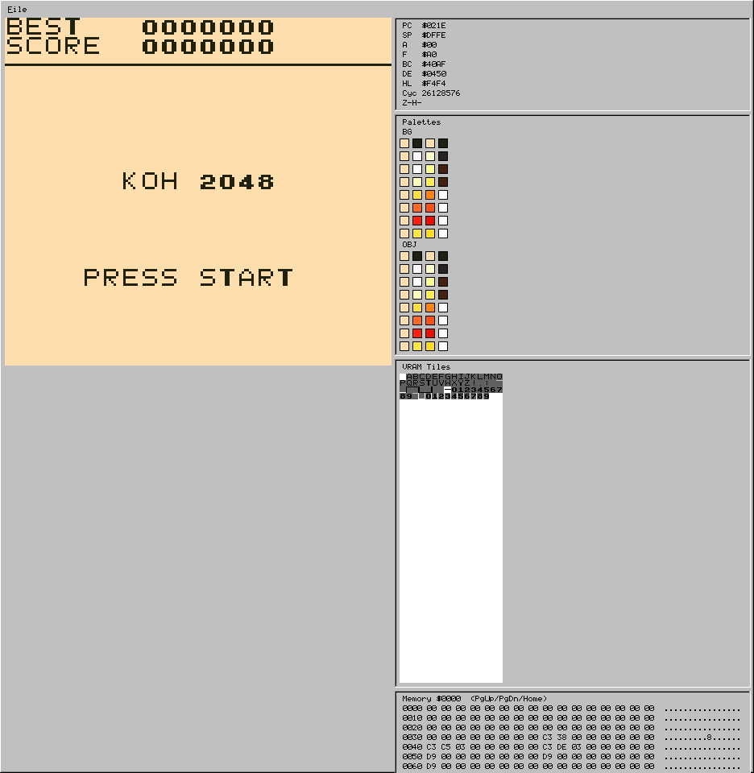

# SDL3 native backend

KohUI uses SDL3 for native windows, events and its 2D Renderer API. OpenAL
continues to provide emulator audio. The headless emulator and DAP paths do
not initialize graphics or audio.

By default the renderer selects a supported Direct3D, Metal or Vulkan renderer
and falls back to software. It excludes SDL's OpenGL and OpenGL ES renderers. Set
`SDL_RENDER_DRIVER=software` to request software rendering. Koh does not use
SDL_GPU or maintain graphics API pipelines, swapchains or shaders. Rectangles
use SDL texture copies with integer source texels; exact atlas coverage is
checked for all 95 printable glyphs in software and native window renderers.

## Binding choice

The selected binding is [edwardgushchin/SDL3-CS](https://github.com/edwardgushchin/SDL3-CS).
Managed `SDL3-CS` and native `SDL3-CS.Windows`, `SDL3-CS.Linux` and
`SDL3-CS.MacOS` packages are pinned together at 3.4.20. The binding project
includes a .NET 10 target; its native packages supply matching platform assets.
The binding and SDL use the [zlib license](https://github.com/edwardgushchin/SDL3-CS/blob/main/LICENSE).
Keep their notices with redistributed source and native libraries.

Alternatives were compared against their own published descriptions:

| Binding | Relevant properties | Decision |
| --- | --- | --- |
| [edwardgushchin/SDL3-CS](https://github.com/edwardgushchin/SDL3-CS) | Managed API plus version-matched native NuGet packages; .NET 10 target; zlib | Selected for the complete desktop package set and direct Renderer API |
| [flibitijibibo/SDL3-CS](https://github.com/flibitijibibo/SDL3-CS) | Generated C-style interop; .NET 8+ CoreCLR variant; zlib | Viable lower-level binding, without a demonstrated packaging advantage for this migration |
| [ppy/SDL3-CS](https://github.com/ppy/SDL3-CS) | Generated binding with desktop native builds; MIT | Viable alternative; replacing the selected binding adds no required behavior |

These comparisons establish API and packaging suitability. NativeAOT support
is established by publishing Koh on each target host, rather than by assuming
that a compatible target framework guarantees trimming or interop correctness.

## Regressions

```sh
dotnet run --project tests/UI/KohUI.Sdl3.Tests -c Release
```

The ordinary suite renders into SDL software surfaces without a video driver
or GPU. It checks RGBA channel order, opaque output alpha, transparent texels,
128/255 alpha blending, nearest scaling at integer and fractional framebuffer
scales, image and font scissors, unchanged source buffers, texture updates,
repeated resource lifetimes and a themed widget gallery. The gallery exercises
layout, keyboard focus, panels, scrolled images and moving image paths.
Images retain their requested integer scale when a parent allocates a larger
layout rectangle; extra space does not stretch the LCD or VRAM pixels.

Native window and input tests are explicitly enabled:

```sh
SDL_VIDEODRIVER=dummy SDL_RENDER_DRIVER=software KOH_SDL_WINDOW_TEST=1 \
dotnet run --project tests/UI/KohUI.Sdl3.Tests -c Release

SDL_VIDEODRIVER=x11 SDL_RENDER_DRIVER=software KOH_SDL_WINDOW_TEST=1 \
xvfb-run -a -s '-screen 0 1280x1024x24 -noreset' \
dotnet run --project tests/UI/KohUI.Sdl3.Tests -c Release
```

Window tests exercise real SDL window creation, resizing, event dispatch and
cleanup. Events are injected through `SDL.PushEvent`; this checks the native
event queue and Koh's handling, rather than physical keyboard or mouse input.
Without the opt-in variable, TUnit reports these cases as skipped.
The input sequence covers mouse clicks, Tab and Shift+Tab focus, Enter,
menu accelerators, text and Backspace, two text events in one polling pass,
model-rejected text, application key callbacks, focus-loss key releases,
window-close callbacks and cancellation cleanup.
The text box sits inside a panel, so batched text events and rejected-edit
acknowledgements exercise nested widget paths as used by the native demo.
SDL text events are decoded as UTF-8; the existing bitmap text widget retains
its printable-ASCII input range.

CI also starts Weston with its X11 backend under Xvfb at output scale 2, then
runs the SDL Wayland driver with both Vulkan and software renderers using
Mesa lavapipe. The X11 host supplies a virtual input seat. The fixture requests
high pixel density and compares renderer output dimensions with
`SDL_GetWindowSizeInPixels`; the tested 96x80 logical resize produces 192x160
physical pixels. This exercises Wayland presentation, events and compositor
scaling without claiming physical desktop behavior.

## Validation limits

The SDL regression project builds with zero warnings and errors. Local runs
produced the following results; each enabled window run also includes the
offscreen tests, including the regression for integer image scale in a stretched
layout rectangle:

| Environment | Result |
| --- | --- |
| Gentoo, no video initialization, SDL software surfaces | 3 passed; 2 window cases explicitly skipped |
| Ubuntu 24.04, SDL dummy video, software renderer | 5 passed; 0 skipped |
| Ubuntu 24.04, Xvfb/X11, software renderer | 5 passed; 0 skipped |
| Ubuntu 24.04, Xvfb/X11, SDL Vulkan renderer with lavapipe | 5 passed; 0 skipped |
| Ubuntu 24.04, Weston/X11 host at scale 2, SDL Wayland plus Vulkan/lavapipe | 5 passed; 0 skipped |
| Ubuntu 24.04, Weston/X11 host at scale 2, SDL software drawing with Vulkan/lavapipe presentation | 5 passed; 0 skipped |

The tested Wayland driver has no raw unaccelerated window framebuffer.
Software drawing therefore uses SDL's CPU renderer with
[`SDL_FRAMEBUFFER_ACCELERATION=vulkan`](https://wiki.libsdl.org/SDL3/SDL_HINT_FRAMEBUFFER_ACCELERATION)
for SDL's final window upload and presentation. That Wayland path still needs
a working Vulkan implementation, including lavapipe; it does not introduce
OpenGL. Dummy and X11 software paths disable framebuffer acceleration and do
not require that presentation renderer. Offscreen software surfaces remain
independent of video initialization.

The serialized full .NET suite passed all 2494 tests with zero failures or skips
before the final nested text-edit and exact-font-copy fixes. Final focused
renderer runs pass all five tests, including those fixes, on dummy video, X11
and Wayland. Linux x64 NativeAOT publishing of both the emulator and UI demo
also completed after those fixes. The latest whole-solution rebuild was stopped
at the user's request; no complete full-suite run followed the final fixes.
Earlier graphics backend results do not establish SDL behavior.
Software rendering does not establish hardware acceleration, presentation
latency, physical display scaling or desktop minimize/restore behavior.
Moving a window between physical monitors with different DPI remains unchecked.
Windows and macOS graphics runtime checks require their own desktop sessions.

## Native emulator

The Linux x64 NativeAOT emulator was published and exercised with the assembly
2048 ROM. DAP hit `$0150`, stepped to `$0151`, continued, paused and disconnected
cleanly. The SDL window was resized, and a mouse click opened the debugger's
CPU, palette, VRAM and memory panels. The capture below was reviewed manually.
It predates the final exact-glyph texture-copy correction.



The executable also produced a 160x144 RGBA PNG and served the same DAP
breakpoint/step sequence from a directory containing no SDL or OpenAL libraries,
with unavailable video/audio drivers. This verifies the headless path separately
from native presentation. Published SDL libraries and their notices are supplied
by the version-matched NuGet packages; source notices are retained under
`licenses/` and copied into application outputs.
