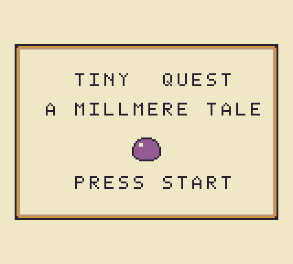
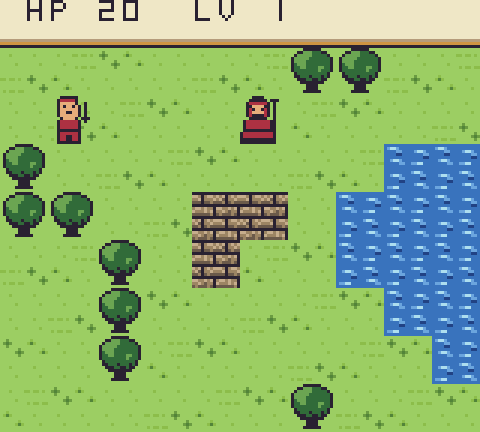
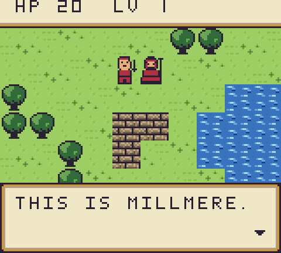
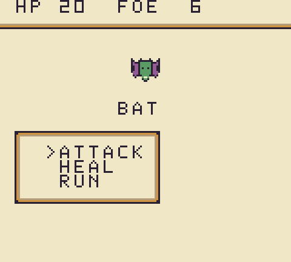

# gb-jrpg — the second north-star sample

A miniature **Game Boy Color-exclusive** JRPG written as ideal C# — boots to a **title screen**
(press Start), then explores the hand-designed **Millmere** overworld (a single-screen map with
a pond, organic shoreline, tree copses, a ruined mill wall, and a dead-end nook), talks to its
villager through paged dialogue, rolls random encounters into a menu-driven turn-based battle,
levels, victory and defeat — authored with no regard for what the compiler supported at the time,
per the ideal-code methodology of
[`docs/superpowers/specs/2026-07-19-ideal-game-api-design.md`](../../../docs/superpowers/specs/2026-07-19-ideal-game-api-design.md).
It builds unmodified through the native Rust compiler/linker. `dotnet build` emits
`jrpg.gb` (header `0xC0`: CGB only, no monochrome fallback).
[Native Rust acceptance](../../../rust/koh-compile/tests/sdk/game.rs) builds the
actual sources and PNG assets in Debug and Release, boots the existing C# emulator,
and checks movement, NPC collision, all dialogue pages, the retained close
callback and a seeded Slime victory with exact HP/experience/RNG state. It also
requires zero mode-3 VRAM writes. See the
[acceptance scope](../../../docs/rust-compiler/jrpg-acceptance.md) for remaining
coverage; this does not claim every combat branch or pixel-perfect art validation.
Native snapshots use temporary test directories. The images below in
[`screenshots/`](screenshots/) are curated documentation assets and are never
written by those tests. Update them deliberately from reviewed captures.

| Title | Overworld | Dialogue | Battle |
|---|---|---|---|
|  |  |  |  |

Characters and monsters are 16×16 figures (2×2 tile blocks); the world walks on a 16×16 cell grid.

## The team polish pass

Art and design were produced by a team of specialized agents (level designer, terrain/character/monster/UI pixel artists) with visual review before acceptance. The seven PNG sheets under [`art/`](art/) now include terrain texture variants (4 grass, 2 wall, 2 water), a 2×2 tree block, and a classic double-line window-frame sheet driving all dialogue and menu windows. The enemy roster grew to four (Slime, Bat, Ghost, Drake) sharing one 4-color battle palette. The UI and battle scenes render on a parchment backdrop with framed windows, delivering a polished, cohesive aesthetic within the Game Boy's constraints.

## The gap catalog this game forced (each was a hard diagnostic when written)

| Construct in this game | What it forced |
|---|---|
| `static readonly byte[,] Map` + `Map[y, x]` (`World.cs`) | Checked mutable rank-two arrays, per-dimension bounds and row-major indexing; see [native contract](../../../docs/rust-compiler/rectangular-arrays.md) |
| `static readonly string[] Lines` (`Actors.cs`) | Typed reference arrays and UTF-16 string length/indexing |
| `new DialogueScene(Lines, () => ...)` (`Scenes.cs`) | Stored callbacks retain their target and captures through constructor fields; native banked invocation and callback return are exercised by the game test |
| `Enemy`/`Scene` hierarchies with virtual methods | Runtime class dispatch, inherited behavior and state through scene transitions |
| `interface IInteractable` on the villager | Declared by the game, but the current sample calls the concrete Villager; this sample alone does not establish interface-call support |

## Art: the PNG tile pipeline (no tile bytes in source)

The sheets under [`art/`](art/) are ordinary PNGs (designed by a dedicated art pass, ≤4 colors
each). At build time the Koh SDK's `KohGenerateTileSheets` target converts them to 2bpp tiles and
generates `static class Art` — tile tables, counts, and each sheet's **actual colors as RGB555
constants**, so the CGB palettes are authored in the PNGs too. `Assets.cs` just loads sheets and
feeds `Art.*Color*` into `Palettes.SetBg`; per-terrain tile attributes (`Bg.SetAttr`) pick the
palette on CGB. The ROM is CGB-exclusive (header `0xC0`), so the dmgShades argument is vestigial.
